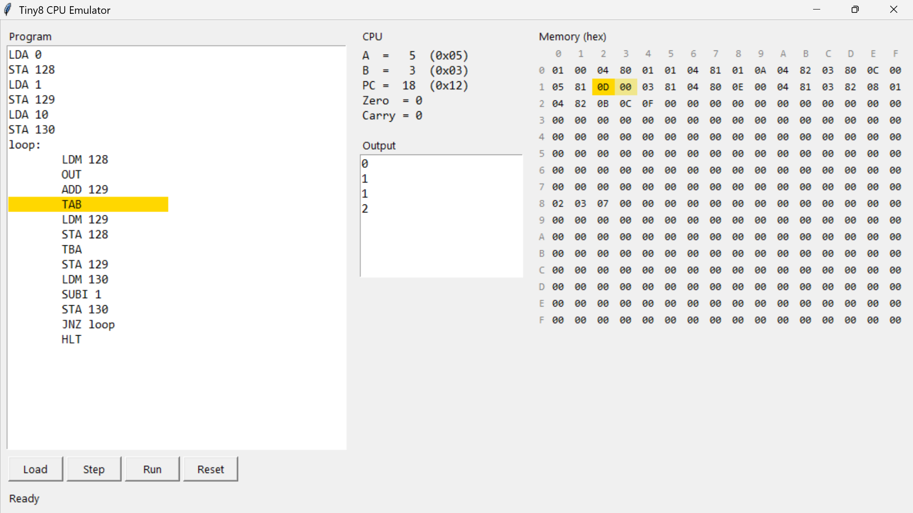

# Tiny8: An 8-bit CPU Emulator and Assembler

Tiny8 is a small imaginary computer written in Python. You write programs in a simple assembly language, an assembler translates them into machine code, and an emulator executes them one instruction at a time.

The project uses only the Python standard library.

I built Tiny8 to understand how a CPU works, including instruction fetching, register operations, flags, memory and program flow.

## What it does

- **CPU:** Two 8-bit registers (A and B), a program counter, Zero and Carry flags, and 256 bytes of memory. Supports 16 instructions.
- **Assembler:** Translates assembly text into machine code. Supports labels, comments, decimal and hexadecimal numbers, and line-specific error messages.
- **Command-line interface:** Assembles and executes programs, with an optional step-by-step execution trace.
- **Graphical interface:** A Tkinter window displaying the program, current instruction, registers, flags, a 16 × 16 memory grid and program output. Includes Load, Step, Run and Reset controls.

## Screenshot



## Quick Start

**Requirements:**

- Python 3.12 or newer.
- Tkinter for the graphical interface (included with most Python installations).

Clone the repository:

```bash
git clone https://github.com/sk518x/tiny8-cpu-emulator.git
cd tiny8-cpu-emulator
```

Run an example using the command-line interface:

```bash
python -m tiny8 examples/countdown.asm --trace
```

Launch the graphical interface:

```bash
python -m tiny8.gui
```

On Windows, you can use `py` instead of `python`.

## Example

The included `examples/countdown.asm` program prints the numbers 5, 4, 3, 2 and 1.

```asm
LDA 5

loop:
    OUT
    SUBI 1
    JNZ loop
    HLT
```

Running the program with `--trace` produces a step-by-step execution trace. The first six instructions look like this:

```text
  1  pc=000  LDA 5     A=5   B=0   Z=0 C=0
  2  pc=002  OUT       A=5   B=0   Z=0 C=0
  3  pc=004  SUBI 1    A=4   B=0   Z=0 C=0
  4  pc=006  JNZ 2     A=4   B=0   Z=0 C=0
  5  pc=002  OUT       A=4   B=0   Z=0 C=0
  6  pc=004  SUBI 1    A=3   B=0   Z=0 C=0
```

Each line shows the step number, instruction address, instruction executed, registers and flags after execution.

Notice that the assembler translates the `loop` label into address `2`. When the `JNZ` instruction executes, the program counter jumps back to that address.

## The Assembly Language

Tiny8 uses a simple assembly language with the following features:

- One instruction per line.
- Semicolons (`;`) start comments.
- Labels use a name followed by a colon, such as `loop:`.
- Jumps can reference labels defined further down in the program.
- Numbers can be decimal (`31`) or hexadecimal (`0x1F`).
- Instruction names are not case-sensitive, but labels are.

See the [Instruction Set](docs/instruction-set.md) for the complete instruction list, flag behaviour and wrap-around rules.

## Examples Included

| File                     | Description                                                            | Steps |
| ------------------------ | ---------------------------------------------------------------------- | ----: |
| `examples/countdown.asm` | Prints 5, 4, 3, 2, 1                                                   |    17 |
| `examples/multiply.asm`  | Multiplies 6 × 7 using repeated addition and prints 42                 |    58 |
| `examples/fibonacci.asm` | Prints the first 10 Fibonacci numbers: 0, 1, 1, 2, 3, 5, 8, 13, 21, 34 |   127 |

## Architecture

The project is organised into separate modules, each responsible for a specific part of the emulator.

```text
tiny8/
    cpu.py          CPU: registers, flags, memory and step()
    assembler.py    Assembly text to machine code
    cli.py          Command-line interface
    controller.py   Coordinates the CPU and GUI
    gui.py          Tkinter graphical interface
```

**CPU (`cpu.py`)**

The CPU handles instruction execution, register updates, flags and memory operations. It has no dependencies on files or graphical components, allowing it to be tested independently.

The `step()` method executes one instruction and returns a copy of the CPU state as a dictionary. Both the command-line trace and graphical interface use this state.

**Assembler (`assembler.py`)**

The assembler translates assembly instructions into machine code. It uses a two-pass approach, allowing labels to reference instructions defined later in the program.

**Controller (`controller.py`)**

The controller sits between the CPU and the graphical interface. It manages loading, stepping, execution, resetting and determining which source line corresponds to the next instruction.

**Graphical Interface (`gui.py`)**

The GUI communicates with the controller rather than accessing the CPU directly. It displays the program state and provides controls for interacting with the emulator.

Keeping the controller separate from the GUI makes the application logic easier to test and keeps the graphical code focused on presentation.

## Tests

Run the automated test suite using:

```bash
python -m pytest
```

The project currently has **68 automated tests** covering:

- All 16 CPU instructions.
- Register, flag and memory behaviour.
- Wrap-around rules.
- Assembler functionality and error messages.
- Command-line execution.
- Controller operations.
- All three example programs running from their assembly files.

Tests run automatically through GitHub Actions using Python 3.12 and the latest Python 3.x version.

**Testing limitation:** The Tkinter drawing code in `gui.py` is not covered by automated tests or executed in CI because the test environment does not have a graphical display. The interface has been checked manually.

## Known Limitations

- The graphical interface has been manually tested rather than covered by automated GUI tests.
- The memory grid uses the Windows-specific `SystemButtonFace` colour. The GUI has only been tested on Windows.
- Editing the program after pressing Load may cause the highlighted source line to become incorrect until the program is loaded again.
- Run executes instructions immediately, up to a limit of 100,000 steps. The window freezes during execution, and there is no execution speed control.
- Every instruction occupies two bytes, including instructions without operands.
- There is no stack, function calling mechanism or interrupt support.
- The emulator supports 8-bit operations only.
- Program instructions and data share the same memory, so a program can overwrite its own instructions.
- The assembler reports the first error it encounters rather than displaying multiple errors at once.

## What I Learned

Building Tiny8 helped me understand CPU architecture, assembly language, memory management and instruction execution. I also gained practical experience with two-pass assemblers, software architecture, test-driven development and debugging.

## Development Process

I developed Tiny8 incrementally, testing each component before bringing everything together.
